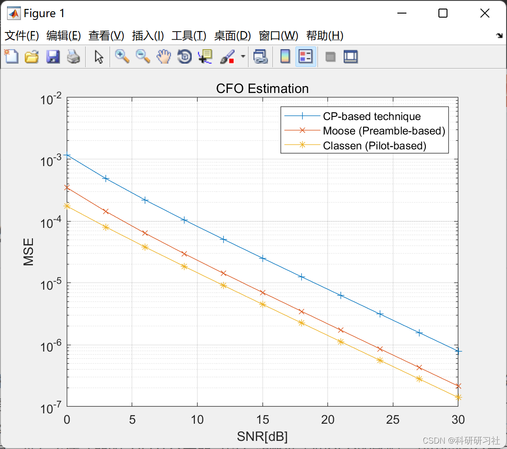

# Signal Processing - CFO Estimation Techniques (Matlab Code Implementation)

1. Overview of the classification for linear modulation with unknown carrier frequency offset (CFO)
A hybrid likelihood ratio test (qHLRT) classifier is proposed in this paper, which addresses the classification of linear modulations with unknown CFO. The performance of the classification is further enhanced by using a multi-antenna receiver. A CFO estimator based on blind source separation technology is used in the qHLRT classifier, while simultaneously estimating phase shifts across different antenna branches. Simulations are conducted on M-level QAM signals over an AWGN channel, and the results show that the qHLRT classifier equipped with this estimator can effectively reduce the impact of unknown CFO, and utilize spatial diversity to further improve the performance of the classifier.
2. Run results
3. Matlab code: This section only showcases part of the code, all codes can be accessed by clicking the link: 
[Signal Processing]CFO Estimation Technique (Matlab Code Realization)
clear, clf\nCFO = 0.15; % Frequency Offset %FFT points %Modulation order \nEs=1; \nA=sqrt(3/2/(M-1)*Es); % Signal Amplitude \nNg=Nfft/4; % Prefix or guard interval length % An OFDM symbol length \nh=complex(randn,randn)/sqrt(2); % Channel impulse response \nfor m=1:Nsym\n   msgint=randi([0,M-1],N); \n   if i<=2\n       Xp = add_pilot(zeros(1,Nfft),Nfft,4); \n       Xf=Xp; \n   else \n      mod_object = modem.qammod('M',M, 'SymbolOrder','gray'); \n      Xf = A*modulate(mod_object,msgint); \n   end                        \n   xt = ifft(Xf,Nfft); \n   x_sym = add_CP(xt,Ng); \n   x= [x x_sym]; \nend    \ny=x; \nsig_pow= y*y'/length(y); \nSNRdBs= 0:3:30; \nMaxIter = 100; \nfor i=1:length(SNRdBs)\n   SNRdB = SNRdBs(i); \n   MSE_CFO_CP = 0; \n   MSE_CFO_Moose = 0; \n   MSE_CFO_Classen = 0; \n   rand('seed',1); \n   randn('seed',1); \n   y_CFO= add_CFO(y,CFO,Nfft); \n   for iter=1:MaxIter\n      y_aw = awgn(y_CFO,SNRdB,'measured'); \n      Est_CFO_CP = CFO_CP(y_aw,Nfft,Ng); \n      MSE_CFO_CP = MSE_CFO_CP + (Est_CFO_CP-CFO)^2; \n      Est_CFO_Moose = CFO_Moose(y_aw,Nfft); \n      MSE_CFO_Moose = MSE_CFO_Moose + (Est_CFO_Moose-CFO)^2; \n      Est_CFO_Classen = CFO_Classen(y_aw,Nfft,Ng,Xp); \n      MSE_CFO_Classen = MSE_CFO_Classen + (Est_CFO_Classen-CFO)^2; \n   end\n   MSE_CP(i)=MSE_CFO_CP/MaxIter; \n   MSE_Moose(i)=MSE_CFO_Moose/MaxIter; \n   MSE_Classen(i)=MSE_CFO_Classen/MaxIter; \nend\nsemilogy(SNRdBs, MSE_CP,'-+')\ngrid on\nhold on\nsemilogy(SNRdBs, MSE_Moose,'-x')\nsemilogy(SNRdBs, MSE_Classen,'-*')\nxlabel('SNR[dB]'), ylabel('MSE'); \ntitle('CFO Estimation'); \nlegend('CP-based technique','Moose (Preamble-based)','Classen (Pilot-based)'); \n
4. References
[1] Cheng Hanwen, Wu Le'nan. Signal modulation method identification based on multi-antenna receiver [J]. Signal Processing, 2009(2):260-263
[2] Li Xuan, Wang Qian. OFDM carrier synchronization technology based on data assistance [J]. Electronic Testing, 2021(3):73-74

## Images

<!-- PAYMENT_BLOCK -->

## Get this dataset

- Payment link (Stripe): [Buy now](https://buy.stripe.com/3cs8yP7sY87d0vu9AB)
- Payment QR code: 

<!-- /PAYMENT_BLOCK -->
